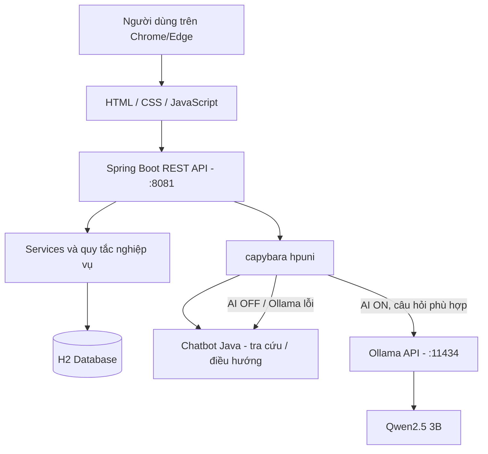

# HPUNI Smart Classroom V2+

> **Hệ thống quản lý lịch học, phòng học và trợ lý capybara hpuni**, phát triển với Java 21, Spring Boot, H2 Database và giao diện web. Có chế độ chatbot nội bộ và chế độ **AI cộng sinh Ollama** (tùy chọn, không cần API key trả phí).

**Trạng thái:** Dự án học tập/đồ án — chạy cục bộ trên Windows. **Không phải hệ thống đã được bảo mật để triển khai công khai trên Internet.**

## Mục lục

1. [Giới thiệu](#1-giới-thiệu)
2. [Các chức năng chính](#2-các-chức-năng-chính)
3. [Công nghệ và kiến trúc](#3-công-nghệ-và-kiến-trúc)
4. [Yêu cầu cài đặt](#4-yêu-cầu-cài-đặt)
5. [Tải mã nguồn từ GitHub](#5-tải-mã-nguồn-từ-github)
6. [Chạy website lần đầu](#6-chạy-website-lần-đầu)
7. [Hướng dẫn sử dụng website](#7-hướng-dẫn-sử-dụng-website)
8. [Trợ lý capybara hpuni và hai chế độ](#8-trợ-lý-capybara-hpuni-và-hai-chế-độ)
9. [Cài Ollama và tải mô hình Qwen](#9-cài-ollama-và-tải-mô-hình-qwen)
10. [Bật/tắt AI cộng sinh ngay trên web (Bài 10.8)](#10-bậttắt-ai-cộng-sinh-ngay-trên-web-bài-108)
11. [Kiểm thử API cơ bản](#11-kiểm-thử-api-cơ-bản)
12. [Cấu trúc mã nguồn và dữ liệu](#12-cấu-trúc-mã-nguồn-và-dữ-liệu)
13. [Đưa thay đổi lên GitHub](#13-đưa-thay-đổi-lên-github)
14. [Xử lý sự cố thường gặp](#14-xử-lý-sự-cố-thường-gặp)
15. [Giới hạn và định hướng phát triển](#15-giới-hạn-và-định-hướng-phát-triển)
16. [Tài liệu tham khảo](#16-tài-liệu-tham-khảo)

---

## 1. Giới thiệu

**HPUNI Smart Classroom V2+** là ứng dụng web hỗ trợ công tác quản lý thông tin và sử dụng phòng học ở phạm vi khoa, gồm:

- Quản lý danh mục phòng học, giảng viên, nhóm/lớp sinh viên, môn học và lớp học phần.
- Xem và cập nhật thời khóa biểu theo tuần.
- Tìm phòng trống theo thời gian và sức chứa; giao diện hỗ trợ thêm điều kiện thiết bị.
- **Xếp lịch tự động hai bước:** xem trước phương án, kiểm tra, rồi **phê duyệt và lưu** khi phù hợp.
- Khai báo lịch bận giảng viên, yêu cầu phòng có máy tính/máy chiếu.
- Tổng quan, biểu đồ, thống kê mức sử dụng phòng và xuất CSV.
- Trợ lý ảo **capybara hpuni** để hướng dẫn thao tác, tra cứu thông tin, điều hướng giữa các trang, ghi nhớ ngữ cảnh tìm phòng.
- **AI cộng sinh Ollama:** sử dụng một mô hình ngôn ngữ cục bộ hỗ trợ trả lời câu hỏi kiến thức; người dùng bật/tắt trực tiếp trong cửa sổ chat.

> Dữ liệu thống kê và phòng trống được tính từ dữ liệu hiện có trong ứng dụng; không tự động bao phủ các lịch đặt phòng bên ngoài hệ thống.

## 2. Các chức năng chính

| Phân hệ | Chức năng tiêu biểu |
|---|---|
| **Tổng quan** | Thống kê nhanh, thời khóa biểu tuần, thao tác nhanh, biểu đồ sử dụng phòng. |
| **Quản lý phòng học** | Xem danh sách, thêm/sửa/xóa, sức chứa, loại phòng, máy chiếu và máy tính. |
| **Quản lý giảng viên** | Quản lý thông tin giảng viên và mã giảng viên. |
| **Quản lý lớp sinh viên** | Quản lý mã lớp, tên lớp và sĩ số. |
| **Quản lý môn học** | Quản lý mã môn, tên môn và số tín chỉ. |
| **Quản lý lớp học phần** | Liên kết môn học – giảng viên – lớp sinh viên theo học kỳ/năm học. |
| **Thời khóa biểu** | Xem lịch theo tuần, lọc, chuyển tuần, thêm/sửa/xóa các buổi học, xuất CSV. |
| **Xếp lịch tự động** | Xếp thử, xem cảnh báo/đề xuất, duyệt và xác nhận lưu lịch; có quy tắc nâng cao. |
| **Tìm phòng trống** | Tra cứu theo ngày, khoảng giờ, sức chứa và các yêu cầu phù hợp. |
| **Thống kê & báo cáo** | Thống kê theo tuần, biểu đồ phân bổ, xếp hạng phòng và xuất CSV. |
| **capybara hpuni** | Chatbot Java + H2, tra cứu, hướng dẫn, điều hướng, hội thoại tìm phòng nhiều lượt, hỗ trợ ngữ cảnh trang. |
| **AI Ollama (tùy chọn)** | Giải thích kiến thức/thuật toán khi bật; không thay thế dữ liệu thật hoặc tự phê duyệt lịch. |

## 3. Công nghệ và kiến trúc

- **Ngôn ngữ:** Java 21.
- **Backend:** Spring Boot **4.1.2**, các REST Controller/Service/Repository, Spring JDBC.
- **Cơ sở dữ liệu:** H2 dạng file, câu lệnh DDL/DML trong `schema.sql` và `data.sql`.
- **Frontend:** HTML, CSS, JavaScript thuần; bố cục Sidebar và chatbot nổi.
- **Build:** Apache Maven, thông qua Maven Wrapper (`mvnw.cmd`).
- **AI tùy chọn:** Ollama chạy local, mặc định model `qwen2.5:3b`.



**Nguyên tắc:** Java và cơ sở dữ liệu xử lý thông tin nghiệp vụ; Ollama **không trực tiếp ghi hoặc xóa lịch học**. Câu hỏi về dữ liệu thật nên sử dụng API nội bộ thay vì để AI tự suy đoán.

## 4. Yêu cầu cài đặt

### Bắt buộc để chạy website (không cần Ollama)

| Thành phần | Yêu cầu |
|---|---|
| Hệ điều hành | Windows 10/11 (hướng dẫn bên dưới dùng PowerShell). |
| Java Development Kit | **JDK 21**. |
| Git | Để tải/cập nhật mã nguồn từ GitHub. |
| Trình duyệt | Chrome hoặc Edge phiên bản còn được hỗ trợ. |
| IDE (tùy chọn) | IntelliJ IDEA; có thể chạy qua Terminal không cần IDE. |
| Maven | Không bắt buộc cài riêng nếu Maven Wrapper hoạt động và có kết nối tải dependencies lần đầu. |

### Bổ sung nếu muốn dùng AI cộng sinh

- Cài **Ollama** trên **máy chạy Spring Boot**.
- Tải mô hình **`qwen2.5:3b`** (file model khoảng 1,9 GB; RAM lúc chạy thường cao hơn).
- Máy có đủ tài nguyên RAM/CPU/GPU. Tốc độ phản hồi phụ thuộc cấu hình máy.
- Để tải Ollama/mô hình lần đầu cần Internet; sau đó có thể chạy mô hình local mà không cần API key dịch vụ đám mây.

## 5. Tải mã nguồn từ GitHub

Mở PowerShell hoặc Terminal, chọn thư mục muốn lưu dự án. **Thay `<USERNAME>` bằng tài khoản GitHub thực tế** của chủ repository:

```powershell
git clone https://github.com/<USERNAME>/hpuni-smart-classroom-v2-plus.git
cd hpuni-smart-classroom-v2-plus
```

Nếu bạn nhận ZIP mã nguồn thay vì clone: giải nén, mở Terminal tại **thư mục chứa `pom.xml` và `mvnw.cmd`**.

> Lưu ý: tên repository GitHub được đề xuất là `hpuni-smart-classroom-v2-plus` (không dùng dấu `+`); tên thư mục cục bộ của tác giả có thể là `hpuni-smart-classroom-v2+`.

## 6. Chạy website lần đầu

### 6.1. Kiểm tra công cụ

Trong PowerShell:

```powershell
java -version
git --version
```

`java -version` nên hiển thị JDK **21**. Trong IntelliJ, kiểm tra **Project SDK** cũng là JDK 21.

### 6.2. Biên dịch

Mở Terminal tại thư mục dự án:

```powershell
.\mvnw.cmd clean package
```

Khi kết thúc thành công, Maven báo `BUILD SUCCESS`. Lần đầu có thể mất thời gian tải dependencies.

### 6.3. Chạy Spring Boot

```powershell
.\mvnw.cmd spring-boot:run
```

Giữ cửa sổ Terminal này hoạt động. Mở Chrome/Edge:

- **Website:** <http://localhost:8081>
- **API kiểm tra:** <http://localhost:8081/api/health>

Để dừng ứng dụng: trở lại Terminal, nhấn **Ctrl + C**.

### 6.4. Dữ liệu H2

Cấu hình trong `src/main/resources/application.properties`:

```properties
server.port=8081
server.address=127.0.0.1
spring.datasource.url=jdbc:h2:file:./data/classroom;DATABASE_TO_LOWER=TRUE;DB_CLOSE_ON_EXIT=FALSE
spring.sql.init.mode=always
```

- Đường dẫn `./data/classroom` là **tương đối với thư mục làm việc** lúc khởi động. Chạy từ thư mục project để dùng đúng database.
- Các file database H2 sẽ được tạo dưới `data/` (ví dụ `classroom.mv.db`).
- `schema.sql` tạo bảng nếu chưa tồn tại; `data.sql` có dữ liệu mẫu và kiểm tra tránh thêm trùng theo mã.
- **Dữ liệu `data/` không nên đưa lên GitHub.** Khi clone mới, dữ liệu cá nhân của tác giả không đi kèm; ứng dụng sẽ khởi tạo dữ liệu theo scripts.
- Khi sao lưu: **dừng Spring Boot trước**, rồi sao lưu thư mục `data/`. Không xóa file database nếu muốn giữ lịch đã nhập.

> Mặc định website chỉ truy cập từ máy chủ (`127.0.0.1`), chưa mở cho các máy khác trong mạng. Muốn triển khai cho người dùng thật cần cấu hình mạng, xác thực, phân quyền và bảo mật phù hợp.

## 7. Hướng dẫn sử dụng website

**Quy trình đề xuất lần đầu:**

1. Vào **Quản lý phòng học** để khai báo phòng, sức chứa, loại phòng và thiết bị.
2. Vào **Quản lý giảng viên**, **Quản lý lớp sinh viên** và **Quản lý môn học** để tạo danh mục.
3. Vào **Quản lý lớp học phần** để gán môn, giảng viên, lớp sinh viên, học kỳ/năm học và số buổi/tuần.
4. Nếu có ràng buộc đặc biệt, vào **Xếp lịch tự động → Quy tắc nâng cao** để khai báo lịch bận giảng viên, yêu cầu máy chiếu/máy tính.
5. Trong **Xếp lịch tự động**, chọn điều kiện phù hợp và nhấn **Xếp lịch thử**. Kiểm tra danh sách đề xuất, thời gian, phòng, cảnh báo.
6. **Chỉ khi kết quả phù hợp**, nhấn **Phê duyệt & lưu lịch**. **Xếp lịch thử không được coi là lịch đã lưu.**
7. Mở **Thời khóa biểu** để kiểm tra các buổi đã lưu; có thể thêm, sửa, xóa buổi cụ thể nếu cần.
8. Dùng **Tìm phòng trống** để tìm phòng theo ngày/giờ/sức chứa; dùng **Thống kê & báo cáo** để xem dữ liệu và xuất CSV.

### Lưu ý về lịch và phòng

- Khung thời gian tìm phòng phải hợp lệ: giờ bắt đầu **trước** giờ kết thúc.
- Một phòng không nên chứa hai buổi học trùng thời gian; lịch giảng viên và lớp cũng cần không trùng.
- Khi xếp lịch, cần xét sức chứa phòng, lịch bận giảng viên và thiết bị môn học yêu cầu.
- Nếu không có phương án xếp lịch, kiểm tra dữ liệu học phần, số buổi, khung giờ, sức chứa, lịch bận và các quy tắc trước khi thử lại.
- Báo cáo thống kê dựa vào thời khóa biểu hệ thống; không phải dữ liệu điểm danh hoặc cảm biến phòng học.

## 8. Trợ lý capybara hpuni và hai chế độ

Ở góc dưới website có linh vật **capybara hpuni**. Di chuột vào linh vật để xem tư thế chào; bấm để mở cửa sổ chat.

### Chế độ trợ lý nội bộ (AI OFF)

**Không cần cài Ollama.** Chatbot dùng các lớp Java và dữ liệu H2 để:

- Trả lời các câu hỏi về phòng học, lớp, giảng viên, lịch đã lưu trong phạm vi bộ quy tắc.
- Hướng dẫn thao tác tại trang đang mở và điều hướng đến trang phù hợp.
- Nhận các câu hỏi tìm phòng nhiều lượt như “Tìm phòng trống” → “Ngày mai” → “9 giờ” → “40 sinh viên”.
- Giải thích các bước xếp thử và xác nhận lịch.

Chatbot này dựa trên quy tắc, **không phải mô hình AI tạo sinh**.

### Chế độ cộng sinh (AI ON)

- Vẫn ưu tiên **Java + H2** cho tra cứu dữ liệu trường, các quy tắc nghiệp vụ và yêu cầu điều hướng.
- Những câu hỏi mang tính giải thích kiến thức hoặc chưa được bộ quy tắc xử lý có thể chuyển sang **Ollama**.
- Ví dụ: “Giải thích thuật toán tham lam và ứng dụng trong xếp lịch học”.
- Ollama không tự truy cập toàn bộ H2 và **không tự thêm/sửa/xóa/phê duyệt lịch**.
- Nếu Ollama không chạy, có lỗi hoặc hết thời gian chờ, chatbot vẫn có cơ chế phản hồi nội bộ; một số câu hỏi ngoài phạm vi quy tắc có thể không được giải đáp đầy đủ.

## 9. Cài Ollama và tải mô hình Qwen

### 9.1. Cài đặt

Tải Ollama dành cho Windows tại: <https://ollama.com/download/windows>.

Sau khi cài, **mở PowerShell mới** và nhập:

```powershell
ollama --version
```

Nếu xuất hiện phiên bản, công cụ đã được nhận diện.

### 9.2. Tải mô hình

```powershell
ollama pull qwen2.5:3b
ollama list
```

Trong danh sách phải có `qwen2.5:3b`. Để trò chuyện thử trực tiếp với mô hình:

```powershell
ollama run qwen2.5:3b
```

Nhập một câu tiếng Việt. Để thoát phiên chat thử, gõ `/bye`.

### 9.3. Kiểm tra Ollama API

```powershell
Invoke-RestMethod http://127.0.0.1:11434/api/tags
```

Nếu thấy thông tin danh sách model, Ollama đang phục vụ API local. Trên Windows, sau khi cài, Ollama thường chạy nền; **không chạy `ollama serve` lần hai nếu cổng 11434 đang được dùng**.

### 9.4. Nếu muốn đổi model

Mặc định trong `src/main/resources/application.properties`:

```properties
hpuni.local-ai.enabled=${HPUNI_LOCAL_AI_ENABLED:false}
hpuni.local-ai.model=${HPUNI_LOCAL_AI_MODEL:qwen2.5:3b}
hpuni.local-ai.url=http://127.0.0.1:11434/api/chat
```

Nếu đổi model, **phải tải model mới** bằng `ollama pull <MODEL>` rồi đặt `HPUNI_LOCAL_AI_MODEL=<MODEL>` trong môi trường chạy Spring Boot (hoặc thay giá trị mặc định ở `application.properties`) và khởi động lại Spring Boot. Với Bài 10.8, **không cần đặt biến `HPUNI_LOCAL_AI_ENABLED=true` để dùng công tắc web**.

## 10. Bật/tắt AI cộng sinh ngay trên web (Bài 10.8)

> Phần này yêu cầu mã nguồn đã cập nhật **Bài 10.8** (có `GET /api/assistant/ai-status` và công tắc AI trong `capybara-chat.js`).

1. Khởi động Spring Boot bình thường:
   ```powershell
   .\mvnw.cmd spring-boot:run
   ```
2. Mở <http://localhost:8081>, bấm capybara hpuni để mở chat.
3. Chọn **AI OFF** nếu chỉ muốn dùng chatbot Java/H2; không cần Ollama.
4. Nếu muốn AI ON, mở Ollama trên máy chạy Spring Boot và bảo đảm đã `ollama pull qwen2.5:3b`.
5. Bật công tắc **AI cộng sinh Ollama** trong chat. Website kiểm tra API/model trước khi bật.
6. Hỏi câu kiến thức: **“Giải thích thuật toán tham lam là gì?”**. Nếu chính Ollama xử lý, phản hồi API có `mode: local-ai`.
7. Muốn tắt, gạt công tắc về **OFF**; từ tin nhắn tiếp theo sẽ không gửi sang Ollama. **Không cần restart Spring Boot.**

**Cách lưu chế độ:** giao diện lưu lựa chọn vào `localStorage` của **trình duyệt hiện tại** (khóa `hpuni.capybara.ai-mode.10-8`), không ghi vào H2 và không ảnh hưởng trình duyệt khác. Khi tải lại trang và đã từng chọn ON, website kiểm tra lại Ollama trước khi khôi phục ON.

**Quan trọng:**

- Bật AI ON chỉ **cho phép gọi** Ollama; không tự khởi động/cài Ollama.
- Với phiên bản Bài 10.8, phía frontend gửi header **`X-HPUNI-AI-Mode: off`** hoặc **`X-HPUNI-AI-Mode: ollama`** theo từng tin nhắn.
- Nếu gọi API bằng Postman mà **không gửi header**, backend có thể dùng giá trị mặc định `HPUNI_LOCAL_AI_ENABLED` (mặc định `false`).
- `GET /api/assistant/health` phản ánh chế độ cấu hình backend, **không nhất thiết phản ánh trạng thái ON/OFF của từng trình duyệt**.
- AI ON nhưng hỏi “Mở thống kê” vẫn có thể trả `mode` của Java: **đúng thiết kế**, vì Java ưu tiên lệnh điều hướng.

### Giải phóng RAM khi không dùng mô hình

```powershell
ollama ps
ollama stop qwen2.5:3b
```

Việc này không xóa model đã tải. Muốn tắt hẳn máy chủ Ollama, chọn **Quit Ollama** tại khay hệ thống Windows. Khi Ollama tắt, **website và chatbot Java vẫn hoạt động**.

## 11. Kiểm thử API cơ bản

Các ví dụ dưới đây chạy trong PowerShell khi Spring Boot đang hoạt động.

```powershell
# Kiểm tra ứng dụng
Invoke-RestMethod http://127.0.0.1:8081/api/health

# Danh sách phòng học
Invoke-RestMethod http://127.0.0.1:8081/api/rooms

# Danh sách giảng viên
Invoke-RestMethod http://127.0.0.1:8081/api/catalog/teachers

# Trạng thái Ollama (Bài 10.8)
Invoke-RestMethod http://127.0.0.1:8081/api/assistant/ai-status
```

**Kiểm tra chat khi AI OFF:**

```powershell
$body = @{ message = 'Danh sách phòng học' } | ConvertTo-Json
Invoke-RestMethod -Method POST `
  -Uri 'http://127.0.0.1:8081/api/assistant/chat' `
  -Headers @{ 'X-HPUNI-AI-Mode' = 'off' } `
  -ContentType 'application/json; charset=utf-8' `
  -Body ([System.Text.Encoding]::UTF8.GetBytes($body))
```

**Kiểm tra khi AI ON:** sửa header thành `'X-HPUNI-AI-Mode' = 'ollama'` và dùng câu hỏi lý thuyết về thuật toán. Nếu phản hồi có `mode: local-ai`, yêu cầu đã được Ollama xử lý.

**Các REST API khác (đã có trong source):**

| Endpoint | Mô tả |
|---|---|
| `GET /api/schedule?weekStart=YYYY-MM-DD` | Lấy lịch của tuần xác định. |
| `GET /api/schedule/available-rooms?date=YYYY-MM-DD&start=09:00&end=10:30&minCapacity=40` | Tìm phòng trống theo lịch hiện có. |
| `POST /api/auto-schedule/preview` | Tạo đề xuất xem trước, **chưa lưu**. |
| `POST /api/auto-schedule/confirm` | Xác nhận lưu bằng mã/đầu vào xác nhận hợp lệ. |

Đừng gọi các API ghi/xác nhận khi đang thử trên dữ liệu quan trọng. Xem class Controller và DTO tương ứng để biết chính xác định dạng JSON.

## 12. Cấu trúc mã nguồn và dữ liệu

```text
hpuni-smart-classroom-v2+/
├── .mvn/                          # Maven Wrapper
├── src/
│   ├── main/
│   │   ├── java/com/smartclassroom/
│   │   │   ├── assistant/          # Chatbot + điều phối Ollama
│   │   │   ├── analytics/          # Thống kê nâng cấp
│   │   │   ├── catalog/            # Giảng viên, lớp, môn, học phần
│   │   │   ├── room/               # Phòng học
│   │   │   └── schedule/           # Thời khóa biểu + xếp tự động
│   │   └── resources/
│   │       ├── static/             # HTML/CSS/JS + ảnh capybara
│   │       ├── application.properties
│   │       ├── schema.sql
│   │       └── data.sql
│   └── test/
├── data/                           # Database H2 local (KHÔNG commit)
├── pom.xml
├── mvnw.cmd
└── README.md
```

**Các bảng nghiệp vụ chính:** `rooms`, `teachers`, `student_groups`, `courses`, `course_offerings`, `schedule_sessions`, `teacher_unavailability`, `course_room_requirements`. Mã nguồn schema còn cần được kiểm tra khi nâng cấp/triển khai mới; không tự ý sửa dữ liệu H2 đang sử dụng.

## 13. Đưa thay đổi lên GitHub

Dành cho người đóng góp hoặc tác giả đang làm việc với repository Git đã tồn tại. **Không chạy `git init` lại nếu thư mục đã có `.git/`.**

```powershell
# Đứng tại thư mục project
cd 'D:\hpuni-smart-classroom-v2+'

# Kiểm tra nhánh và remote
git branch --show-current
git remote -v
git status
```

Nếu chưa có `origin`, tạo repository trống trên GitHub rồi dùng:

```powershell
git remote add origin https://github.com/<USERNAME>/hpuni-smart-classroom-v2-plus.git
```

Nếu `origin` đang trỏ tới repository cũ, dùng `git remote set-url origin <URL-THỰC-TẾ>` thay vì `remote add`.

### Không đẩy dữ liệu/sản phẩm build hoặc thông tin bí mật

`.gitignore` nên loại trừ tối thiểu:

```gitignore
# Biên dịch và IDE
target/
.idea/
*.iml

# Dữ liệu H2 và file runtime
data/
*.mv.db
*.trace.db
*.lock.db

# Biến môi trường và bí mật
.env
.env.*
*.log

# Sao lưu cá nhân (cần chọn lọc theo dự án)
*.bak
*.backup
```

> `.gitignore` không tự bỏ theo dõi file đã commit trước đây. Kiểm tra bằng `git ls-files data target` trước khi push. Nếu một file dữ liệu/build **đang được Git theo dõi**, dùng `git rm -r --cached -- data target` (chỉ với các đường dẫn đang được theo dõi) rồi commit. `--cached` không xóa dữ liệu khỏi ổ đĩa; nhưng dữ liệu đã có trong lịch sử Git vẫn cần xử lý riêng nếu nhạy cảm.

### Đưa mã nguồn lên repository đang có

```powershell
# Chỉ stage mã nguồn/cấu hình an toàn, tránh stage cả data/
git add README.md .gitignore pom.xml mvnw mvnw.cmd .mvn src

# Xem chính xác file sắp commit
git diff --cached --name-only
git diff --cached --check

git commit -m "docs: add setup and Ollama user guide for HPUNI V2+"

git push origin main
```

Nếu có các file Java/JS của Bài 10.8 chưa được commit, chúng sẽ nằm trong nhóm `src` khi stage. Trước khi push, kiểm tra `git diff --cached` để chắc chắn không vô tình chứa API key, mật khẩu, dữ liệu cá nhân hoặc file runtime.

Nếu Git báo `nothing to commit`, kiểm tra `git status`. Nếu báo push bị từ chối vì nhánh remote đã có thay đổi, **không dùng `--force`**; cần `git fetch` và xem sự khác biệt, sau đó đồng bộ phù hợp.

## 14. Xử lý sự cố thường gặp

| Hiện tượng | Cách kiểm tra |
|---|---|
| `java` không chạy / sai JDK | `java -version`; chọn JDK 21 trong IntelliJ. |
| Maven `BUILD FAILURE` | Đọc dòng `[ERROR]` đầu tiên; chạy trong thư mục chứa `pom.xml`. |
| Cổng 8081 đang bận | Tắt bản Spring Boot khác; không chạy đồng thời hai phiên cùng cổng. |
| Trang không cập nhật JS/CSS | Nhấn `Ctrl + Shift + R`; kiểm tra file trong `src/main/resources/static/`. |
| Không thấy công tắc AI | Xác nhận đã cài bản vá Bài 10.8; kiểm tra `capybara-chat.js` và `capybara-chat.css`. |
| Bật AI ON bị từ chối | Chạy `ollama list`, kiểm tra `qwen2.5:3b` và `http://127.0.0.1:11434/api/tags`. |
| Chatbot trả theo Java dù AI ON | Bình thường với câu điều hướng/tra cứu; thử câu học thuật về thuật toán. |
| Ollama chậm | Chờ model tải vào RAM, kiểm tra tài nguyên, giảm model nếu cần. |
| Đã có database mà dữ liệu biến mất | Kiểm tra đang chạy từ cùng thư mục làm việc và dùng đúng `./data/classroom`. |
| Người khác không truy cập được từ máy khác | `server.address=127.0.0.1` chỉ nghe trên máy cục bộ; dự án chưa cấu hình triển khai mạng. |

## 15. Giới hạn và định hướng phát triển

Bản hiện tại phù hợp cho mục đích **học tập và minh họa nghiệp vụ**. Trước khi sử dụng thật cho nhiều người hoặc đưa ra Internet, cần kiểm tra và bổ sung:

- Xác thực người dùng, phân quyền quản trị/giảng viên/giáo vụ.
- Xử lý đồng thời khi nhiều người ghi lịch, kiểm thử ràng buộc và giao dịch.
- Giới hạn yêu cầu chatbot/API, log an toàn và sao lưu/khôi phục dữ liệu.
- Chuyển sang cơ sở dữ liệu phù hợp vận hành nhiều người (ví dụ PostgreSQL).
- Bảo mật mạng, HTTPS, quản lý cấu hình triển khai và dịch vụ Ollama.
- Đánh giá chất lượng câu trả lời AI trên tình huống thực; câu trả lời của mô hình có thể sai.

**Đặc biệt:** công tắc AI trong trình duyệt (`localStorage` / request header) là **tùy chọn sử dụng**, không phải cơ chế xác thực hay phân quyền.

## 16. Tài liệu tham khảo

- [Java](https://www.oracle.com/java/technologies/downloads/)
- [Spring Boot](https://docs.spring.io/spring-boot/)
- [Maven](https://maven.apache.org/)
- [H2 Database](https://www.h2database.com/)
- [Ollama Windows](https://ollama.com/download/windows)
- [Ollama API](https://docs.ollama.com/api/introduction)
- [Model Qwen2.5 trên Ollama](https://ollama.com/library/qwen2.5)
- [GitHub Docs – Push local repository](https://docs.github.com/en/migrations/importing-source-code/using-the-command-line-to-import-source-code/adding-locally-hosted-code-to-github)

---

**HPUNI Smart Classroom V2+** — mã nguồn phục vụ mục đích học tập, nghiên cứu và phát triển đồ án. Vui lòng cập nhật thông tin tác giả/nhóm thực hiện và đường dẫn repository chính thức nếu cần.
## 17.TÁC GIẢ
-Đặng Trung Kiên
